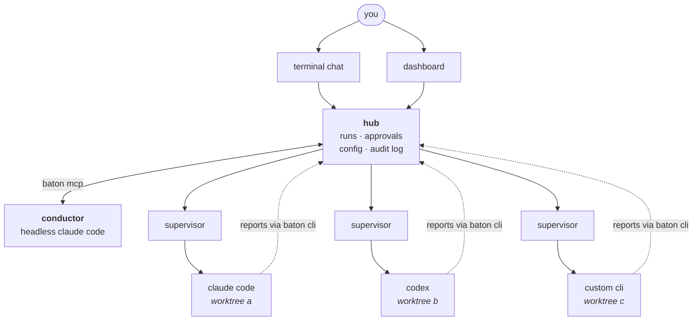

# baton

run a bunch of coding agents at once (claude code, codex, opencode, or really anything that can
run a shell command) across your accounts. one conductor agent splits up the work and keeps
things moving, you approve the important stuff, and there's a dashboard to watch it all.

it only runs the official clis and never touches your login tokens. everything stays on
127.0.0.1.

## what it does

1. run `baton` in a repo and tell the conductor what you want done
2. the conductor proposes a **lineup**: how many agents, which account and model each uses, and
   a plan for each. you ok it or edit it
3. every agent gets its own git worktree and branch, so nobody steps on anyone
4. agents report progress and ask questions; the conductor answers, reviews their diffs and asks
   you before merging
5. you watch it live in the dashboard or chat with the conductor in the terminal

if the hub dies, agents keep going and it catches up after, no lost or duplicated messages.

## how it works



all of it is one go binary.

- **hub**: a background process per repo. tracks runs, hands out worktrees, enforces account
  limits, holds approvals, flags agents that go quiet and serves the api + dashboard
- **conductor**: a headless claude code session the hub owns. it can only read the project and
  call baton's tools through `baton mcp` (spawn, read events, answer, review diffs, ask to
  merge). its conversation survives restarts, and the hub wakes it when an agent needs it
- **supervisors**: one detached process per agent, writing the agent's output to files instead
  of pipes. that's why agents outlive the hub; on restart it re-adopts them. kill takes the whole
  process tree
- **adapters**: turn each cli's native output into tool calls, edits and token usage, so you see
  activity even if an agent never reports. new kinds can be added in the config
- **dashboard**: typescript + three.js, embedded in the binary. per-agent panels (answer,
  message, pause, stop, kill), approvals, spawn form, config, a 3d map and a scrubbable timeline.
  works on a phone too

## the protocol

agents report with a tiny cli:

```
baton hello
baton plan --confirm
baton step s1 start
baton progress 40 "parser done, tests next"
baton ask "sqlite or postgres?" --options sqlite,postgres --blocking
baton step s1 done --summary "..." --evidence "go test ./... ok"
baton done --status success --summary "..."
```

if the hub is unreachable (or the agent is sandboxed with no network), the same messages go to a
file in the run folder that the hub tails later. every message has a `msg_id`, so re-reading the
file never stores anything twice. the json schemas in `protocol/schema/` are the source of truth
for go and the dashboard; details in `protocol/PROTOCOL.md`.

## accounts and modes

accounts live in `~/.baton/config.yaml` (per-repo overrides in `baton.config.yaml`). each one
has its own cli config folder, which is how two logins of the same cli sit side by side.
`baton login <account>` logs one in. the config reloads live; every key is in
`baton.config.example.yaml`.

`hub.mode` decides how much the conductor does alone: `user` (you spawn), `propose` (default,
lineups wait for your ok) or `auto`. merges need your ok by default, are real `--no-ff` merge
commits, are refused on conflict, and an ok is tied to the reviewed commit.

opencode is built but stays off until it has an api-key provider (never a claude subscription).

## security

agents run `sandboxed` by default: they write only to their own worktree and run folder, can't
move `main`, can't read `~/.baton` (logins, tokens, other runs) or your `deny_read` paths, and
have no network.

- codex uses its own sandbox (`mxc` on windows). with `permissions.ask: true` a blocked codex
  agent asks you in the dashboard instead of failing; a network grant covers any host for the
  rest of that run, and relies on experimental codex features
- claude uses claude code's sandbox, which exists only on macos, linux and wsl2. on native
  windows a sandboxed claude account refuses to start. claude agents can't ask for access yet
- `permissive` turns all of it off: the agent can do anything you can, including approving its
  own merge. only for repos you'd trust a script with

the conductor's token can't approve anything, each agent's token only works for its own run,
and none of them come from your claude or openai logins.

## building

needs go (see `go.mod`), node 24+ and git.

```
npm install
npm run check           # fmt, vet, all tests, dashboard typecheck
npm run build           # dashboard + binary -> dist/baton
npm run release         # windows/macos/linux binaries + SHA256SUMS -> dist/release/
npm run install:baton   # puts baton on your PATH
```

## using it

```
baton login my-claude    # once per account
baton                    # in a repo: hub + conductor, dashboard, and the chat
```

- ctrl+c only leaves the chat; `baton attach` comes back. `--no-chat` skips it
- `baton up`: hub + dashboard without the conductor, spawn agents yourself
- `baton hub status` / `baton hub stop`
- `baton gc`: cleans up old worktrees and run folders (asks first, never touches live runs or
  branches)
- chat commands: `/agents`, `/approvals`, `/approve`, `/reject`, `/mode`, `/model`, `/effort`,
  `/stop`, `/help`

**no quota?** `baton mock` runs a fake conductor and fake agents on a scratch repo so you can
click around the dashboard for free (`--speed 5`, `--seed N`, `--once`, `--reset`).

## status

phases 1-7 of 8 done and tested; claude, codex and the conductor have all done real runs. ci is
green on windows, macos and linux. next: claude agents asking for access like codex ones, and
claude inside wsl2 on windows. phase 8 (remote access) isn't planned yet.

## docs

- `protocol/PROTOCOL.md`: how agents and the conductor talk to the hub
- `docs/GO_HUB_DESIGN.md`: how it's built and why
- `docs/PLAN.md`: the plan
- `HANDOFF.md`: where things stand right now
